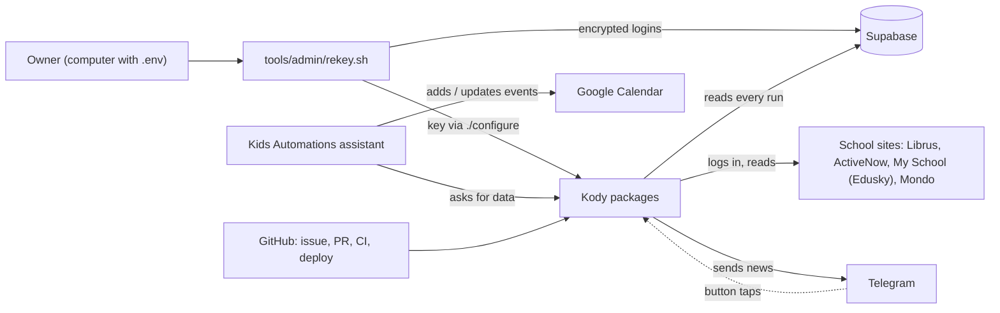

# System overview

This page shows the whole system on one screen. Details are in `docs/kody-deploy.md`.

## 1. The flow

## 2. Who does what

| Who | Responsible for |
| --- | --- |
| Owner | Accounts, passwords, Kody secrets and secret approvals, approval of changes, the `.env` file on the own computer |
| Kids Automations assistant | Code changes through issues and PRs, routines, calendar sync, monitoring |
| Kody | Runs the packages: timed jobs, webhooks, the payments dashboard app |
| Supabase | Family settings, children, recipients, fees, encrypted logins (`credentials` table) |
| GitHub Actions | Tests every PR. After merge: deploys to Kody and runs database migrations |
| Telegram | Alerts to Recipients, Paid / Skip buttons for payments |
| Google Calendar | Where results end up (one calendar per child) |

## 3. Where logins and keys live

| What | Where | Who can see it |
| --- | --- | --- |
| School logins (Librus, ActiveNow, My School/Edusky with `EDUSKY_CLIENT_SECRET`, Mondo) | Supabase table `credentials`. AES-256-GCM, format `v1.<iv>.<ct>`, additional data `familyId:name` (`packages/shared/src/credentials.ts`) | Only package code that has the key |
| `CREDENTIAL_KEY` | Owner's `.env` and the storage of each package, set by `./configure` | Owner and packages. Never an agent. It cannot be a Kody secret: Kody secrets are only `{{secret:NAME}}` placeholders filled on outgoing fetch, and decryption needs the raw key |
| `SUPABASE_KEY` (restricted role `automations_watcher`, host `<ref>.supabase.co`) | Kody secret. Used by librus-watch, activities-watch, payments-watch, kradziejka | Nobody reads it. Kody inserts it only on calls to allowed hosts |
| `TELEGRAM_BOT_TOKEN` (Librus polling bot, host `api.telegram.org`) | Kody secret. Used by librus-watch, activities-watch, payments-watch | Same |
| `telegramBotToken-kradziejka` (separate bot) | Kody secret. Used by kradziejka | Same |
| `JEV_API_KEY` (host `api.getjevai.com`) | Kody secret. Used by kradziejka | Same |
| `LIBRUS_USER`, `LIBRUS_PASSWORD` | Old Kody secrets. **Legacy, Owner can delete.** No package code reads them (logins are now in Supabase) | Nobody |
| Bot webhook keys of kradziejka | AES-256-GCM ciphertext in `kradziejka_bots` (not Kody secrets) | Only package code that has the key |
| Deploy token `KODY_DEPLOY_TOKEN` | GitHub environment secret (environment `kody`). A long token lasts 90 days at most and expires after 14 days unused | GitHub Actions deploy job |

A database leak alone gives only ciphertext. A package config leak alone gives a key with no data.

## 4. How requests are allowed

| Rule | In plain words |
| --- | --- |
| Secrets are placeholders | Code writes `{{secret:NAME}}`. Kody fills in the value on the way out. |
| Allowed hosts per secret | `SUPABASE_KEY` works only for the Supabase host. Librus secrets never go to `api.telegram.org`. |
| Approval per package | The Owner must allow a package in Kody before it can use a secret. |
| Webhooks | A webhook uses a secret URL (`url-secret` verification). |
| ActiveNow | At most one fetch per 24 h per account. Results are cached. After a block (HTTP 403) wait 24 h. No retry. No header tricks. |
| My School (Edusky) | The login uses GET, because Cloudflare blocks POST from a data-center network (`packages/activities-watch/src/edusky-source.ts`). |

## 5. What starts each job

| Package / job | Cron (`package.json`) | What it does |
| --- | --- | --- |
| librus-watch `scheduled-check` | `0 7,18 * * *` | New Librus items to Telegram |
| librus-watch `daily-purge` | `30 3 * * *` | Removes old stored items |
| activities-watch `scheduled-check` | `0 7,18 * * *` | Cancelled or moved after-school classes to Telegram |
| payments-watch `scheduled-check` | `0 8 * * *` | Due fees to Telegram with a ZBP QR code |
| payments-watch webhook `telegram-update` | Owner taps Paid / Skip | Marks the fee in Supabase |
| payments-watch app (dashboard) | Owner opens it and logs in | Shows fees and payments |
| kradziejka webhooks `telegram-update`, `reply`, `register` | Incoming messages | Routes allowlisted chats to bots. No timed jobs |

The cron expressions have no time zone in `package.json`. `docs/kody-deploy.md` says the schedule time zone must be the Family time zone (Europe/Warsaw), and lists 07:00/18:00, 03:30 and 08:00. Whether Kody runs these crons in UTC or in the Family zone: **to confirm**.

## 6. How results get back to the assistant and into Google Calendar

| Routine | When (Europe/Warsaw) | What happens |
| --- | --- | --- |
| Librus → Child A calendar | 07:15, hourly 14:00–20:00, 22:00 | Reads Librus data from Kody (read-only), compares with the calendar, adds or updates events |
| Activities → Child B calendar | 07:20 and 18:20 | Reads ActiveNow / My School / Mondo data from Kody, adds or updates events |
| Loop monitor | Every 30 min while the Sandcastle loop runs | Reports only merges and problems |

| Calendar rule | Example |
| --- | --- |
| Lesson title: `<Child>: <nr>. <subject>` | `Child: 3. Math` |
| Test or homework | In the title. Reminder at 16:00 the day before |
| Grades | In the lesson description |
| Teacher message | In that teacher's next lesson, or its own event |
| Recurring events without a sync key | Never delete them |

Routines only read from Kody. The Owner hears only about changes or failures. The routines live in the assistant, not in this repository.

## 7. How code changes ship

1. A GitHub issue (label `Sandcastle` and `priority: …`).
2. The Sandcastle loop writes the code and opens a PR.
3. All CI checks are green. No direct pushes to main.
4. Squash merge. The deploy workflow publishes private packages to Kody. Migrations update Supabase. To roll back, deploy the previous version.

## 8. What to do when…

| Situation | Do this | Deploy needed? |
| --- | --- | --- |
| A password changed | Edit `.env`, then `git checkout main && git pull && bash tools/admin/rekey.sh` | No |
| New `CREDENTIAL_KEY` wanted | Run `rekey.sh` (new key, re-encrypts all, calls `./configure`) | No |
| Check one stored login without showing it | `admin verify-credential` (see `docs/kody-deploy.md`) | No |
| Code must change | Issue, PR, green CI, auto deploy | Automatic |
| A package asks for a secret | Owner approves it in Kody | No |

> Why no deploy after rekey: each package reads its config (with the key) again on every run.

## 9. Known open items

| Item | Status |
| --- | --- |
| Telegram webhook for payments buttons (mint `telegram-update` and `setWebhook`) | **to confirm** |
| Allow `SUPABASE_KEY` for payments-watch (dashboard) | **to confirm** |
| Cron time zone on Kody (UTC or Europe/Warsaw). Payments time is 08:00 in the repo, 10:00 expected | **to confirm** |
| Legacy Kody secrets to delete (Owner) | open |
